# Relatório

## Identificação
**Nome:** Lucas Valmir Lopes de Melos  
**Matrícula:** 2024333016  
**Turma:** 913A  
**Data:** 26/10/2026  
**Título:** Laboratório de Sistemas Operacionais e Redes (LSOR)

---

## Informações Gerais do Laboratório

Para manter a padronização das práticas, a compatibilidade de redes e a segurança nos testes, adotamos as seguintes diretrizes de ambiente de hardware e credenciais:

*   **Hipervisor:** [VirtualBox](https://www.virtualbox.org/)
*   **Sistema Operacional Guest:** Ubuntu Server 26.04 LTS (64-bit) .
*   **Hardware Padrão da VM:** 2048 MB de Memória RAM, 2 CPU Virtual e 32 GB de Disco Rígido.

---

## O que foi realizado nessa aula
Preparação e instalação do sistema linux Ubuntu_Server no ambiente virtual do VirtualBox. Dentro disso, foi visto como definir Idioma, Teclado, Rede e Perfil. Além de como particionar o disco para instalação.

## Diretórios Necessários

### Diretório da ISO
Criar uma série de pastas no disco C para salvar a iso necessário para instalar o sistema na pasta Original. A iso pode ser baixada através desse [link](https://ubuntu.com/download/server/thank-you?version=22.04.5&architecture=amd64&lts=true).  
  

### Diretório Importante
Preparar outra sequência de pastas no disco C. Dessa vez é para servir de armazenamento do sistema rodando na VM.
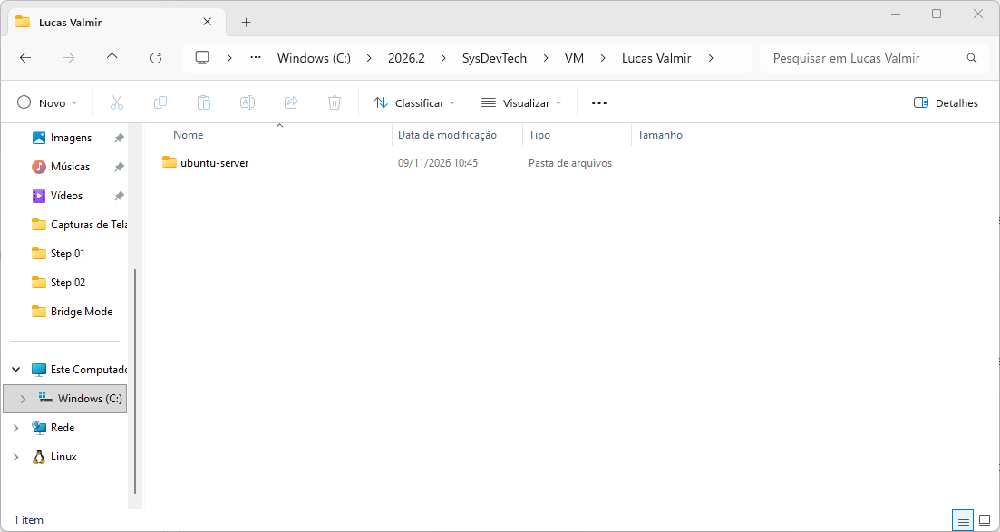  

## Criação da Máquina Virtual

### Início do VirtualBox
Após abrir o VirtualBox, o objetivo de agora é criar uma Máquina Virtual com o Sistema Ubuntu Server. Para isso só basta clicar em "Novo".
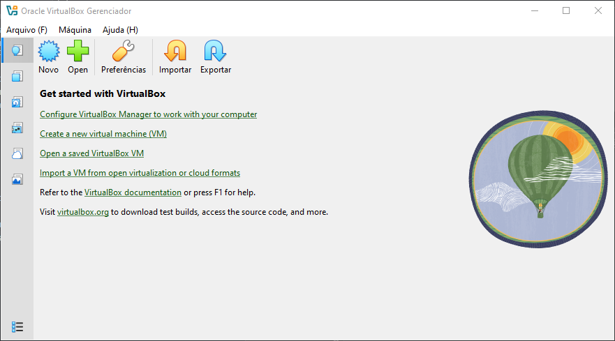  

### Definições Iniciais
Com a nova tela aberto, só basta aplicar as seguintes configurações:
- VM Name: Nome da Máquina Virtual
- VM Folder: Pasta que será usada para armazenar o funcionamento do Ubuntu Server. (C:\2026.2\SysDevTech\VM\Nome_Usuario\ubuntu-server)
- ISO Image: Arquivo que é preciso para instalar o Sistema. (C:\2026.2\SysDevTech\VM\Original\ubuntu-26.04-live-server-amd64.iso)
- OS: Tipo do Sistema (Linux)
- OS Distribution: Distribuição usanda (Ubuntu)
- OS Version (Ubuntu 64-bit)      

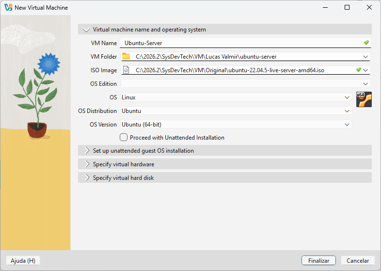   

### Hardware Virtual
Na aba **Specify virtual hardware** ajuste "Base Memory" para 768 MB e "Number of CPUs" para 1. O Sistema não exige muitos recursos de Hardware, então oferecendo pouco ele já consegue trabalhar de boa.  
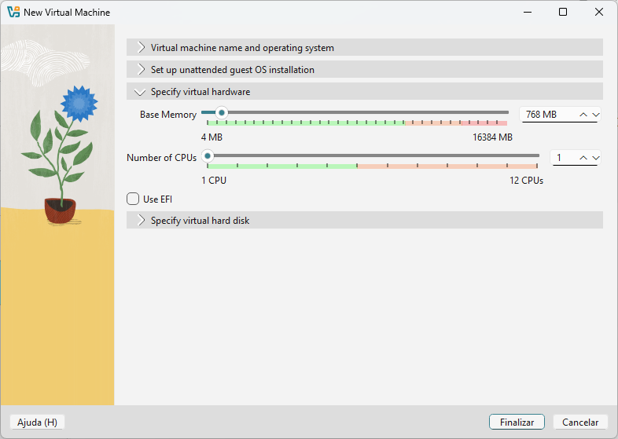
  
### Disco Virtual
Agora na aba **Specify virtual hard disk** vamos definir a capacidade de armazenameto que já vai ficar certo para a VM. Recomendamos 32 GB para o Sistema trabalhar sem preocupações do usuário.  
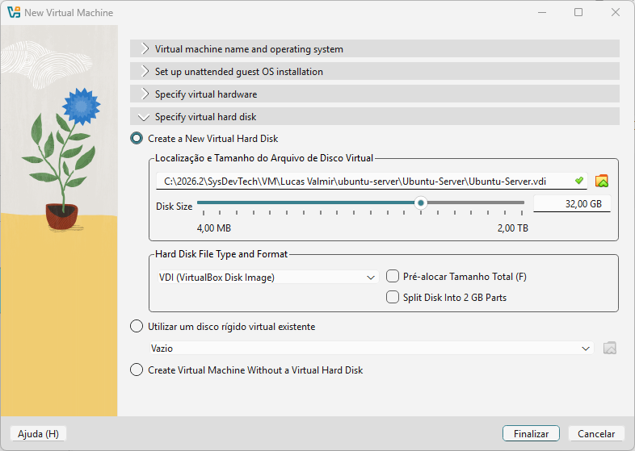

### O Botão Finalizar
Após definir e ajustar as configurações necessárias para criar uma Máquina Virtual, é preciso realizar uma ação muito importante que conclui essa etapa: clicar no botão inferior direito, onde está escrito "Finalizar".  
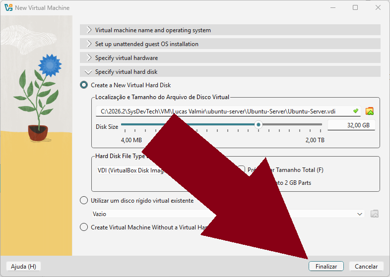

## Instalação do Sistema

### Botão Iniciar
Agora o próximo passo é executar pela primeira vez a Máquina Virtual para instalar o Ubuntu-Server. Na tela inicial do Virtualbox, perceba que foi criado um novo item. Selecione ele e tenha certeza que está selecionado para clicar em Iniciar.  
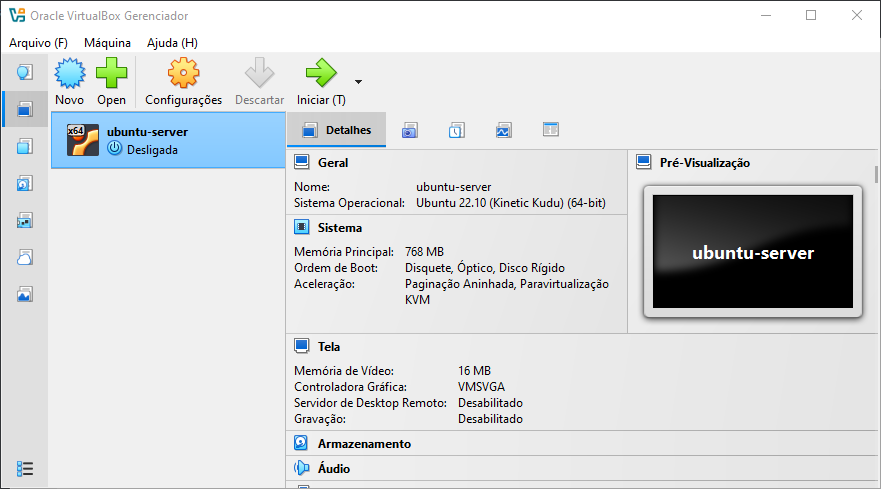  

### Try or Install
Logo no início aparecerá um menu para escolher uma ação. A ação que iremos ir é "Try or Install Ubuntu Server".  
Os comandos são feitos nas setas do teclado e no botão Enter para confirmar.  
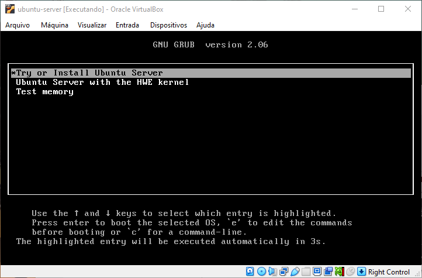  

### Linguagem
Próxima tela é para escolher o idioma. Recomendamos deixar Inglês mesmo para treinar a língua.  
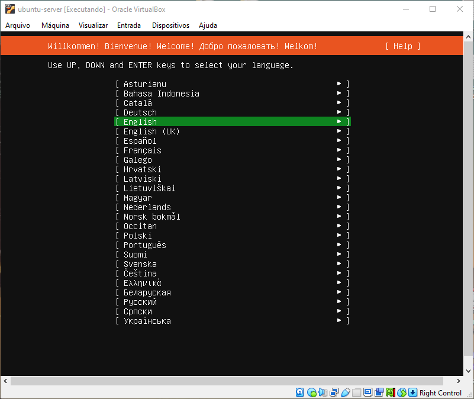  

### Layout do Teclado
Agora é para definir o estilo do teclado. Aqui depende do seu teclado, mas como estamos no Brasil a escolha pode ser "Portuguese (Brazil)".  
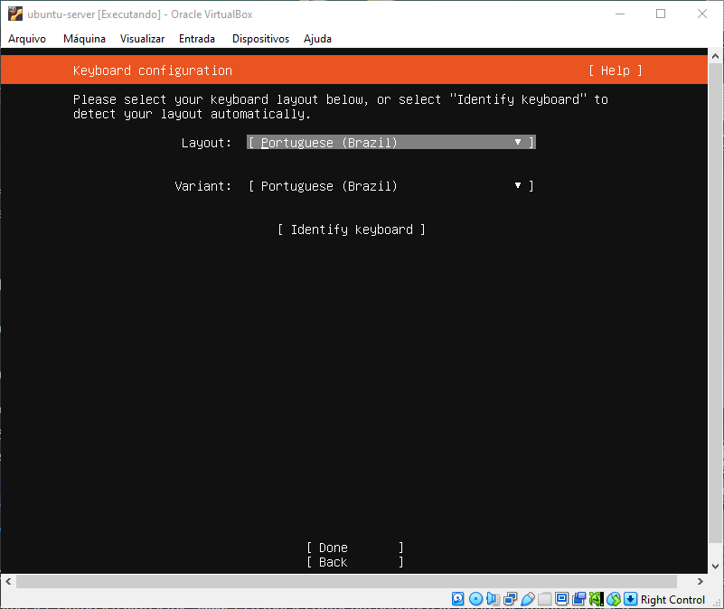  

### Confirmação do Ubuntu Server
Já nessa tela pede para escolher qual Sistema instalar. Escolha a primeira opções e siga em Done.  
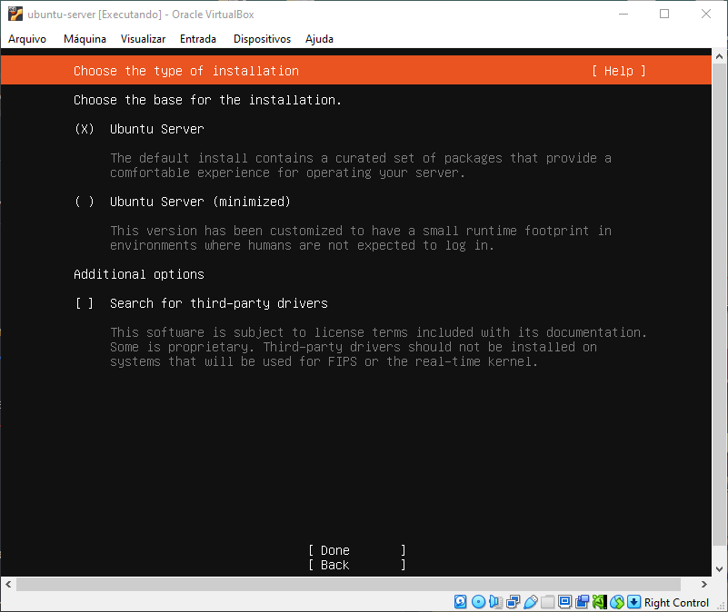  

## Definições de Rede

### Rede
Aqui irá mostra a interface virtual de rede e seu endereço IP. Não mexa em nada, apenas siga em Done.  
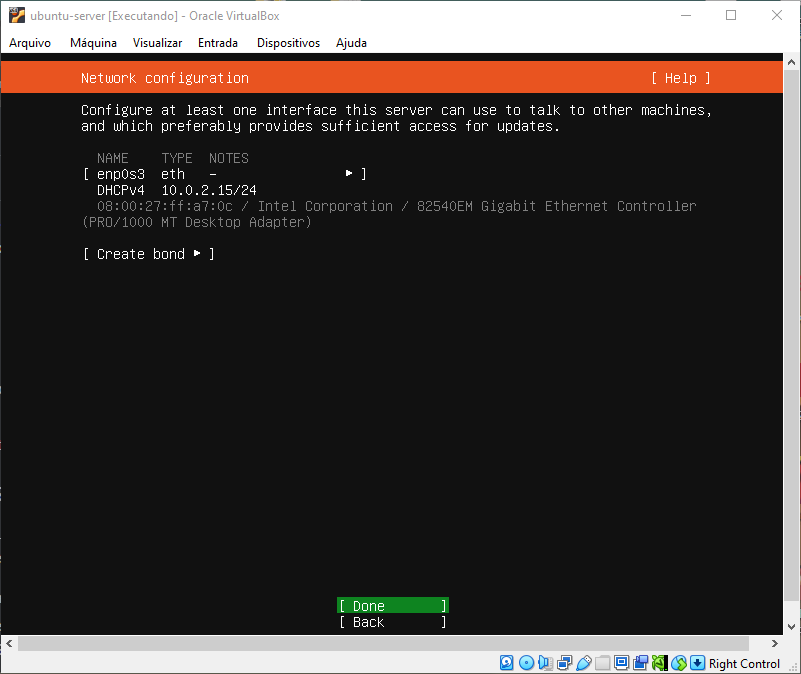  

### Proxy
O mesmo se repete aqui... Não mexa em nada, apenas siga em Done.  
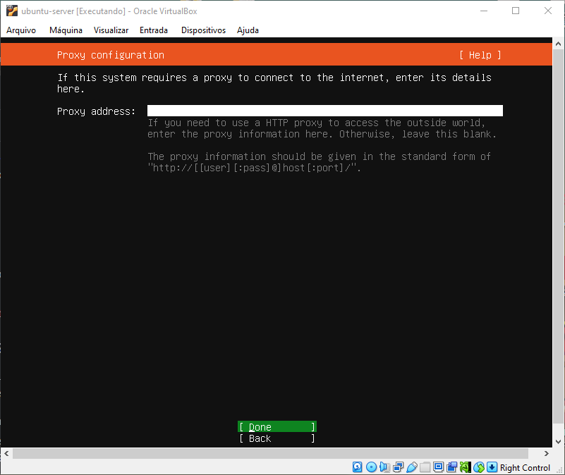  

### Mirror
Já nessa página algumas coisas irá carregar. Você apenas esperar e seguir em frente clicando em Done.  
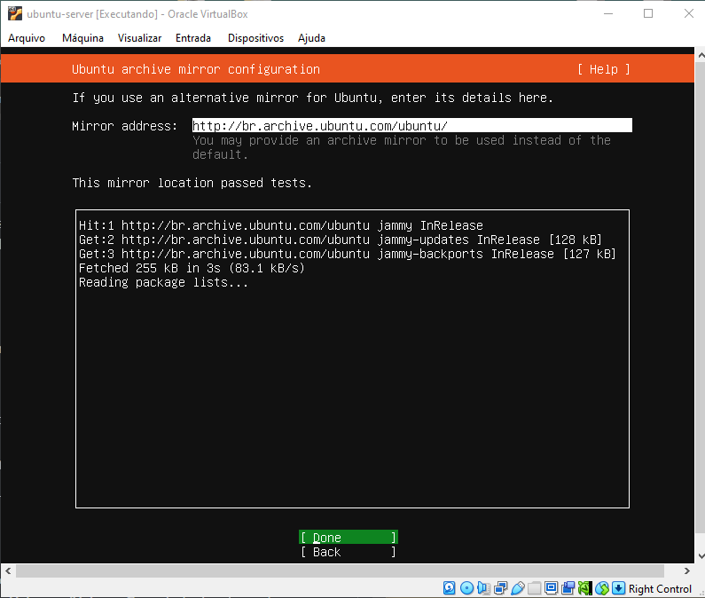  

