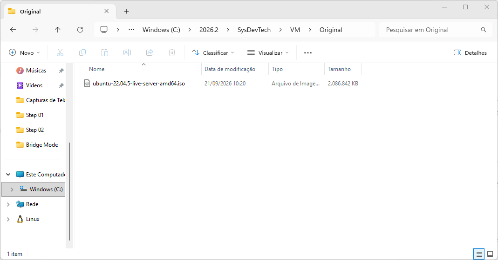
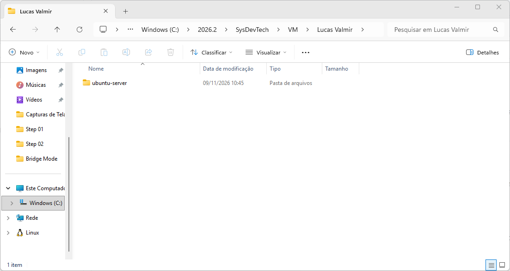

# Relatório

## Identificação
**Nome:** Lucas Valmir Lopes de Melos  
**Matrícula:** 2024333016  
**Turma:** 913A  
**Data:** 26/10/2026  
**Título:** Laboratório de Sistemas Operacionais e Redes (LSOR)

---

## Informações Gerais do Laboratório

Para manter a padronização das práticas, a compatibilidade de redes e a segurança nos testes, adotamos as seguintes diretrizes de ambiente de hardware e credenciais:

*   **Hipervisor:** [VirtualBox](https://www.virtualbox.org/)
*   **Sistema Operacional Guest:** Ubuntu Server 26.04 LTS (64-bit) .
*   **Hardware Padrão da VM:** 2048 MB de Memória RAM, 2 CPU Virtual e 32 GB de Disco Rígido.

---

## O que foi realizado nessa aula
Preparação e instalação do sistema linux Ubuntu_Server no ambiente virtual do VirtualBox. Dentro disso, foi visto como definir Idioma, Teclado, Rede e Perfil. Além de como Particionar o disco para instalação.

## Diretórios Necessários
  
  