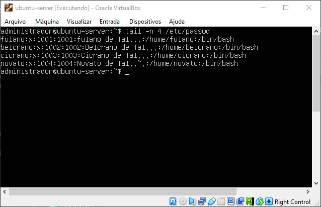
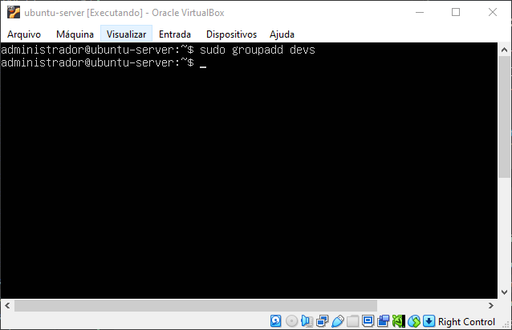
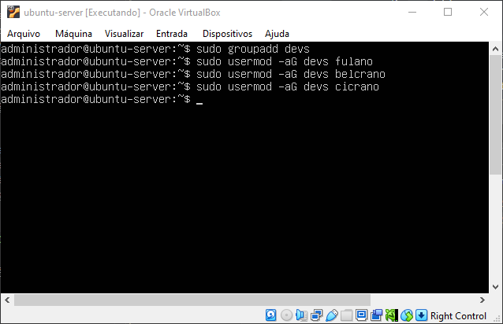

# Relatório

## Identificação
**Nome:** Lucas Valmir Lopes de Melos  
**Matrícula:** 2024333016  
**Turma:** 913A  
**Data:** 26/10/2026  
**Título:** Laboratório de Sistemas Operacionais e Redes (LSOR)

---

## Informações Gerais do Laboratório

Para manter a padronização das práticas, a compatibilidade de redes e a segurança nos testes, adotamos as seguintes diretrizes de ambiente de hardware e credenciais:

*   **Hipervisor:** [VirtualBox](https://www.virtualbox.org/)
*   **Sistema Operacional Guest:** Ubuntu Server 26.04 LTS (64-bit) .
*   **Hardware Padrão da VM:** 2048 MB de Memória RAM, 2 CPU Virtual e 32 GB de Disco Rígido.

---

## Nessa aula o que foi realizado
Apresentados conceitos de administração de usuários, grupos e acessos de diretórios no Ubuntu-Server. Além de ações práticas para memorização do conteúdo.

## Teorias Fundamentais
Sistemas Linux a segurança e integridade são bases para um modelo de propriedade e privilégios. Arquivos ou diretórios possue:
- **Usuário Dono** (-u): normalmente quem cria o arquivo.
- **Grupo Associado** (-g): Conjunto de usuários que possuem características semelhanes.
- **Outros** (-o): Qualquer outro usuário que não seja dono ou esteja num grupo associado a algo.  

Os 3 itens apresentados podem receber permissões:
- **Leitura** (Read -r): Permite ser ler e ser listado.
- **Escrita** (Write -w): Permissão de criar, modificar ou apagar.
- **Execução** (Execute -x): Permite exeutar algo (programa, script etc).

## Criação de Usuários
Vamos criar um cenário: uma infraestrutura de desenvolvedores que usam o mesmo sistema. Para que isso seja possível, é preciso que o sistema suporte mais de um usuário. O ubuntu-server permite isso. Só basta os desenvolvedores terem conhecimentos de administrar nessa área.

### Fulano
Para criar uma conta de usuário de forma simples é usar o comando **adduser**. Assim um diretório será criado para armazenar as coisas desse indivíduo e um próprio interpretador de comandos.  
  
Perceba que antes do comando principal existe o sudo. Ele é usado para que o comando seguinte tenha privilégios de administrador. E por último é o nome do novo usuário: fulano.

### Outras contas
Como normalmente uma infraestrutura tem vários funcionários, é preciso aumentar a quantidade de usuários no sistema. Então vamos adicionar mais contas: cicrano, belcrano e novato.

### Conferir contas criadas
Existe um meio para analisar as contas dos usuários que foram criadas no sistema. Isso é usando o tail, um programa para mostrar últimas linhas de um arquivo. O diretório do arquivo é: "/etc/passwd".   

## Grupos dos Desenvolvedores
Para reunir e gerenciar permissões de forma escalável, é interessante criar um grupo de uni a equipe de desenvolvimento.

### Criação de um grupo
O comando é groupadd. Como ele precisa de privilégios de administrador para funcionar, sudo vem no começo da linha. No final da linha é o nome do grupo. Essa é a formula para criar um grupo chamado devs.  
  

### Comando de adicionar e sua estrutura
usermod é quem vamos usar. Ele também precisa de privilégios, então o sudo é preciso no início. Em seguida vem as flags de "adicionar" (a) e "grupo" (G). E no final o nome do grupo e quem será inserido nele.  
Estrutura: sudo usermod -aG <GroupName> <UserName>  
  
O que a gente fez aqui foi adicionar o fulano, belcrano e cicrano no grupo devs. Deixamos o novato de fora para que ele represente perfil externo (Outros).  

### Conferir indivíduos no grupo
É possível validar se os usuários que colocamos em devs estão lá mesmo. Para esse fim, o comando grep. Ele é usado para buscar palavras-chaves em um arquivo.  
Veja em baixo como conferir o resultado:  
  

