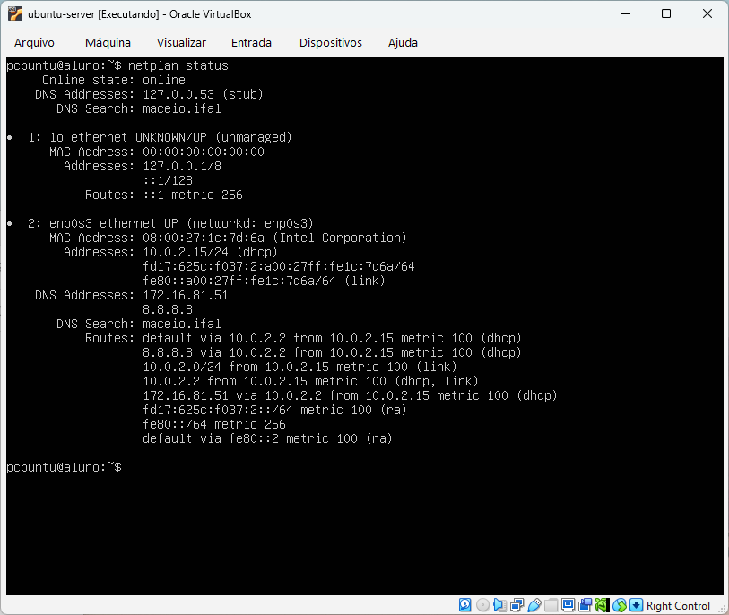
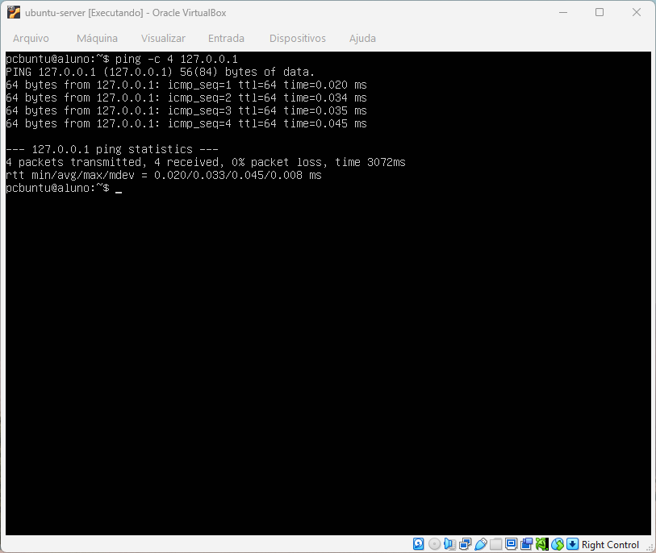
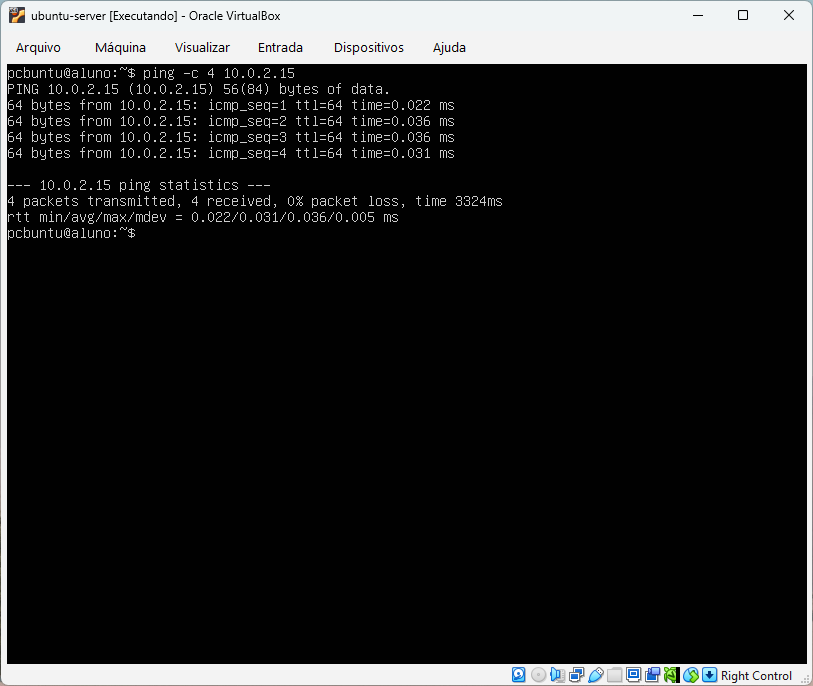
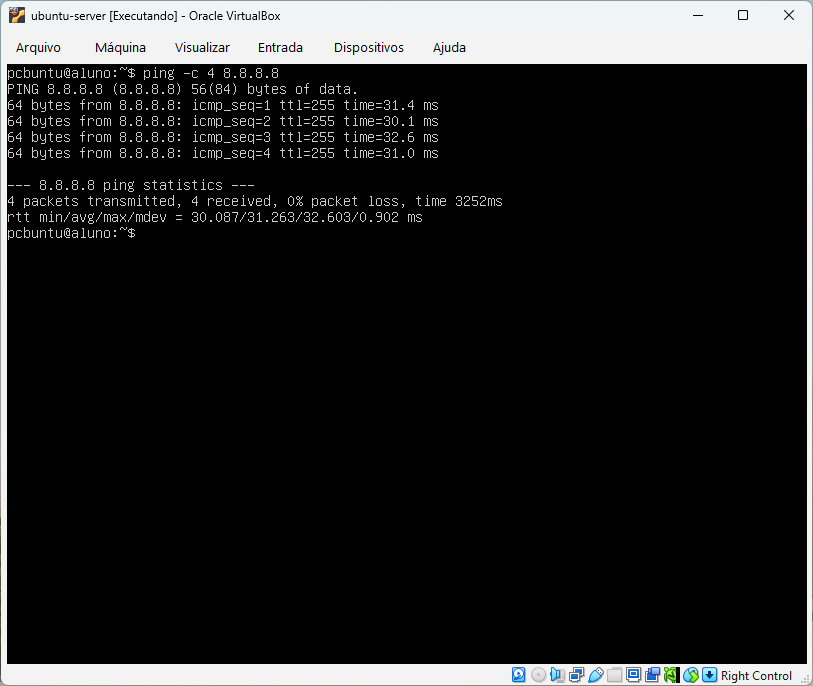
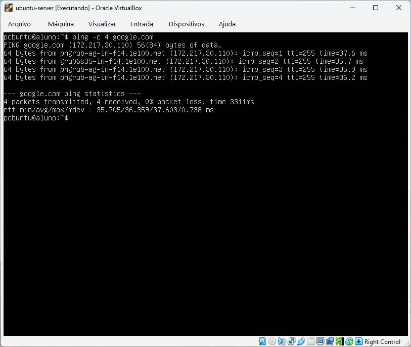

# Relatório

## Identificação
**Nome:** Lucas Valmir Lopes de Melos  
**Matrícula:** 2024333016  
**Turma:** 913A  
**Data:** 26/10/2026  
**Título:** Laboratório de Sistemas Operacionais e Redes (LSOR)

---

## Informações Gerais do Laboratório

Para manter a padronização das práticas, a compatibilidade de redes e a segurança nos testes, adotamos as seguintes diretrizes de ambiente de hardware e credenciais:

*   **Hipervisor:** [VirtualBox](https://www.virtualbox.org/)
*   **Sistema Operacional Guest:** Ubuntu Server 26.04 LTS (64-bit) .
*   **Hardware Padrão da VM:** 2048 MB de Memória RAM, 2 CPU Virtual e 32 GB de Disco Rígido.

---

## O Que Foi Realizado Nessa Aula
Execuções de linhas de comando para analisar informações básicas de rede da VM e do sistema, como endereço de IP, endereço MAC, DNS etc. Também foi possível inspecionar o comportamento de rotas e testar conectividade de camadas. Além de aprender diferenciar o modo NAT do modo Bridge.

## Comandos Usados
As linhas de comandos a seguir foram executadas no NAT Mode da VM para buscar algumas informações.
- ip addr show
- ip link
- ip route
- netplan status

Ainda sendo executados no mesmo ambiente, mas com algumas variáveis para acessar outras informações.
- ping -c 4 10.0.2.2
- ping -c 4 8.8.8.8
- ping -c 4 127.0.0.1
- ping -c 4 google.com
- ping -c 4 10.0.2.15

## Testes e Explicações

### ip addr show
  
O principal motivo de usar esse comando é descobrir o **endereço IP**. Essa informação pode ser encontrada logo em baixo de link/ether. Nesse caso, é possível ver que é **10.0.2.15**.   
Outra informação é a **mascara de sub-rede: /24**. Isso significa que 10.0.2 é fixo, facilitando a comunição em rede local. 

### ip link
  
Mostra as placas e dispositivos de rede disponíveis, seus nomes e endereços MAC.   
Aqui temos 2 interfaces de redes: loopback, usado para realizar teste locais; e rede de Ethernet para acessar internet. Além disso, é possível visualizar o **endereço MAC da interface de Ethernet**. Está depois de link/ether: **08:00:27:1c:7d:6a**.

### ip route
   
Com esse comando também é possível visualizar o IP da VM. Mas o que chama atenção é o **endereço do gateway padrão: 10.0.2.2**.

### netplan status
  
Esse comando mostra o resumo do estado da rede e os principais dados: IP, gateway e DNS.

### ping -c 4 127.0.0.1
  
Vamos começar a testar a conectividade de rede. Como primeiro teste: enviar pacotes para o próprio sistema da VM (Ubuntu Server).

### ping -c 4 10.0.2.15
 
Esse outro teste é quase parecido com o anterior, a diferença é que a placa de rede precisa está ativa para ter sucesso na resposta.

### ping -c 4 10.0.2.2
  
Já esse outro testa se o Ubuntu Sever consegue acessar o roteador virtual do VirtualBox, enviando pacotes para ele.

### ping -c 4 8.8.8.8
  
Esse testa se pacotes conseguem passar da rede do computador físico e serem enviados para a internet.

### ping -c 4 google.com  
  
Se os pacotes conseguirem chegar num sevidor (o google foi escolhido), significa que o teste foi bem sucedido.

